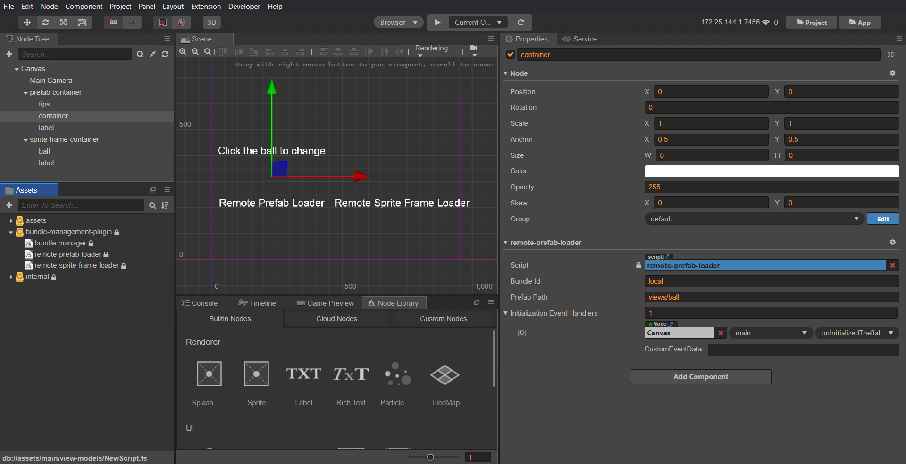
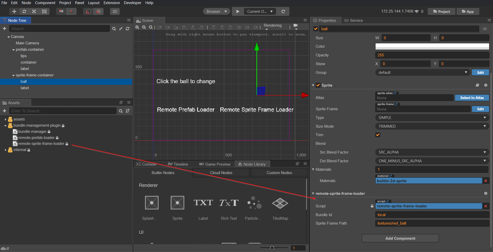

# Bundle Management for Cocos Creator

## Manual installation

Clone this project to your computer. Copy folder `dist/bundle-management` to cocos's project `<project path>/packages`

## Bundle Information Configuration

After installing the extension, it will create the file `<cocos project>/assets/resources/bundle-information.js` with content:

```javascript
window.bundleInfos = {
  [bundle id]: {
    url: "the bundle url",
    name: "the bundle name",
  },
};
```

Example:

```javascript
window.bundleInfos = {
  package: {
    url: "http://example.com/bundle",
    name: "package",
  },
};
```

---

**NOTE**

Because we use a global variable (`window.bundleInfos`) to store bundle information so that all configurations should place in the **main project**. And in the **remote project** only use for development and testing.

---

## Components

### 1. Remote Prefab Loader

Load and instantiate prefab from the remote bundle.



**Properties**

- `Bundle Id`: Defined in file `<cocos project>/assets/resources/bundle-information.js`.

- `Prefab Path`: The relative path to this prefab in a bundle. For example, the bundle has two folders _views_ and _view-models_, in _views_ has a file named _ball.prefab_. The path to the _ball.prefab_ is `views/ball` (without file extension).

- `Initialization Event Handler`: The callback methods will be called after the prefab is created.

### 2. Remote Sprite Frame Loader

Load sprite frame from the remote bundle and assign to Sprite Component.



**Properties**

- `Bundle Id`: The bundle id.
- `Sprite Frame Path`: The relative path to this sprite frame in a bundle.
